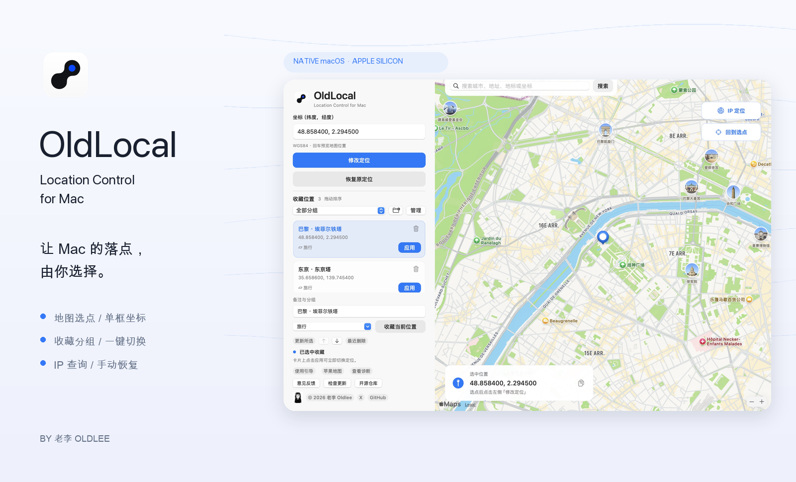

**让 Mac 的落点，由你选择。**

地图选点 · 经纬度输入 · 收藏切换 · IP 区域查询

**[下载 OldLocal](https://github.com/Oldleeo/OldLocal/releases/latest)**　·　**[图文教程](docs/USER_GUIDE.md)**　·　**[常见问题](docs/FAQ.md)**　·　**[意见反馈](https://github.com/Oldleeo/OldLocal/issues)**

由 [老李 Oldlee](https://x.com/oldleeoo) 制作 · 原生 AppKit + MapKit

---

## OldLocal 是什么？

OldLocal 是运行在 **Mac 本机** 的定位工具。粘贴经纬度，或在地图上选择一个位置，点击「修改定位」，就可以让支持该系统定位来源的应用使用模拟位置。使用结束后，点击「恢复原定位」。

它把坐标输入、地图预览、收藏管理和位置切换放进同一个窗口：常用位置不用反复复制，操作结果不用去终端寻找。

> [!IMPORTANT]
> OldLocal 修改的是本机系统定位模拟参数。它不改变公网 IP，也不控制 iPhone；不同应用可能使用不同的定位来源，需要在目标应用中实际核对。**关闭 OldLocal 不会自动恢复位置。**

## 可以用来做什么？

| 使用场景 | OldLocal 如何帮你 |
| :--- | :--- |
| 测试自己的位置相关应用 | 在不同公开测试坐标之间切换，检查位置展示、地域逻辑与边界情况。目标应用是否采用模拟位置，需要实际验证。 |
| 反复使用同一组测试位置 | 添加备注，按「旅行」「测试」等分组保存，再从收藏卡片一键应用。 |
| 已有坐标，想知道它在哪里 | 粘贴 `纬度, 经度`，按回车看地图，确认后再应用。 |
| 只知道城市、地址或地标 | 从自动补全建议中选择，或在地图上直接点击落点。 |
| 比较 IP 区域和选定位置 | 查询公开 IP 或当前网络出口的区域坐标；结果先预览，再决定是否应用。 |

## 看一眼界面

**左边管理位置，右边查看地图。** 坐标单框输入，收藏直接应用，右上角搜索与 IP 查询，左下角查看操作状态和更新。

配图基于 2.3.0 原生界面，以巴黎、东京、首尔等公开地标演示。截图使用隔离的示例数据，不读取个人收藏，也不执行系统定位修改；地图落点代表选点预览。

## 安装与第一次使用

### 1. 下载，放到应用程序

在 [最新 Release](https://github.com/Oldleeo/OldLocal/releases/latest) 的 **Assets** 下载 **`OldLocal-macOS-arm64.zip`**。解压后，把 `OldLocal.app` 拖入「应用程序」。

`Source code (zip)` 是开发者源码包；直接使用软件，请下载带 `macOS-arm64` 的应用包。

### 2. 打开，启用定位组件

每次启动都会显示引导。首次使用点击「启用定位组件」，在 **macOS 管理员弹窗** 完成授权。就绪后进入软件，日常修改与恢复无需每次输入密码。

上图展示组件就绪后的引导。首次安装或更新后，主按钮显示「启用定位组件」。

### 3. 选点，应用，再恢复

1. **选点**：粘贴坐标、搜索地标、点击地图，或选择收藏。
2. **预览**：核对坐标与地图。回车预览、搜索、IP 查询不会直接修改系统定位。
3. **应用**：点击「修改定位」或收藏卡片「应用」，查看状态，在目标应用核对。
4. **恢复**：使用结束后点击「恢复原定位」，确认恢复结果。

**[完整操作教程 →](docs/USER_GUIDE.md)**

## 功能，展开看

### 地图与坐标：找到你要的落点

<table>
<tr>
<td width="50%"> <b>坐标直接粘贴</b> 使用 <code>48.858400, 2.294500</code> 这样的单框格式，纬度在前。回车预览地图，确认后应用。</td>
<td width="50%"> <b>搜索与地图选点</b> 支持城市、地址和地标建议；也可点击地图直接选点。「回到选点」将视野拉回所选位置。</td>
</tr>
</table>

### 收藏：一次整理，多次使用

<table>
<tr>
<td width="50%"> <b>备注、分组、一键应用</b> 常用位置保存在本机。点击卡片填回坐标；点击「应用」直接切换。上下箭头可调整顺序。</td>
<td width="50%"> <b>看得见的管理入口</b> 点击分组旁「管理」重命名或删除。删除分组会把收藏移到「未分组」，保留备注与坐标；窗口内可撤销最近操作。</td>
</tr>
</table>

卡片右上角垃圾桶和右键菜单均可删除收藏，可从「最近删除」恢复。**删除收藏或分组不会改变已经应用的定位。** 详见 [收藏操作](docs/USER_GUIDE.md#favorites)。

### IP 区域查询：把网络出口的位置放到地图上

「IP 定位」支持 IPv4 / IPv6，也可查询当前网络出口。返回区域名称与估计坐标，点击「使用此坐标」填回主界面，再决定是否修改定位。

查询由 **[ipapi.co](https://ipapi.co/api/)** 提供。IP 区域结果不是设备 GPS 精确位置；VPN 或代理开启时可能对应代理出口。只有点击查询按钮才请求当前出口。

### 反馈与更新：软件里直接找到入口

<table>
<tr>
<td width="50%"> <b>报告问题 / 功能建议</b> 在 GitHub 编辑后自己提交；预填版本与系统信息，不自动附带坐标、收藏或诊断。</td>
<td width="50%"> <b>检查正式版更新</b> 显示 GitHub Releases 最新版本和说明。新版本下载后手动替换，收藏保留。</td>
</tr>
</table>

## 系统要求与实际边界

| 项目 | 当前情况 |
| :--- | :--- |
| 处理器 | 发行包为 **Apple Silicon / arm64**，没有提供 Intel 版。 |
| 最低系统 | 构建目标为 **macOS 15+**。 |
| 实际定位验证 | macOS **15.7.4** 已验证参数读回、失败回退、服务刷新及此前 Apple Maps 显示结果。其他系统版本未逐一验证。 |
| 管理员授权 | 首次启用需要；更新后需让组件认可新签名。日常操作免重复授权。 |
| 网络 | 地图、搜索、IP 查询、更新检查需要网络；收藏保存在本机。 |
| 应用签名 | **ad-hoc 签名，未经过 Apple 公证**。系统拦截时，查看「系统设置 → 隐私与安全性」是否提供允许打开选项。 |
| 公网 IP / VPN | 不改变 IP、不提供 VPN；IP 查询只显示区域估计。 |
| iPhone / iPad | 不修改它们的位置；这是 Mac 本机工具。 |

系统的定位模拟偏好不是稳定的公开设置接口，后续 macOS 更新可能改变行为。请按软件结果和目标应用实际显示核对。软件不要求关闭 SIP，也不要求重启 Mac。

## 遇到问题，先看这里

<b>地图选好了，为什么其他应用的位置没变？</b>

选点只是预览，需要点击「修改定位」。应用后先检查状态；Apple Maps 可能有缓存，可退出后重新打开并点击当前位置。其他应用也可能使用 IP 或独立数据来源。

<b>更新软件后为什么又要输入一次密码？</b>

后台组件认可已批准的软件签名。新版签名变化后，进入「使用引导 → 启用定位组件」更新批准；日常修改与恢复仍免重复输入密码。

<b>「修改未完成，参数已回退」怎么办？</b>

本次修改没有被视为成功，之前参数已恢复。打开「查看诊断」了解结果；要结束测试，点击「恢复原定位」并检查状态。不要删除原备份，也不要把地图预览当作成功证明。

<b>分组怎么删除？收藏会丢失吗？</b>

分组筛选旁「管理」→ 选择分组 →「删除分组」。收藏移到「未分组」，默认「未分组」不能删除。窗口内可撤销最近一次分组操作，关闭后撤销记录结束。

**[更多问题、恢复和卸载步骤 →](docs/FAQ.md)**

## 开源与参与

原生 Swift / AppKit / MapKit 应用，没有第三方 Swift 包依赖。后台通过本机 XPC 执行受限的定位设置与恢复，核对参数读回和服务刷新。

- **[开发、构建、测试与发布](docs/DEVELOPMENT.md)**：从源码生成可安装应用。
- **[贡献说明](CONTRIBUTING.md)**：报告问题、提出建议与改进代码。
- **[更新记录](CHANGELOG.md)**：了解版本变化。
- **[隐私与数据](docs/PRIVACY.md)**：本机文件、网络请求和组件权限。

**老李 Oldlee**

[X · @oldleeoo](https://x.com/oldleeoo)　·　[GitHub · Oldleeo](https://github.com/Oldleeo)　·　[反馈与建议](https://github.com/Oldleeo/OldLocal/issues)

Copyright © 2026 老李 Oldlee

软件代码采用 **[MIT License](LICENSE)**。位置后端基于 TimBitBox 的 MIT 项目，原许可和署名保留，见 [第三方说明](THIRD_PARTY_NOTICES.md)。OldLocal 品牌、Logo 和作者形象的使用范围也在该说明中列出。
