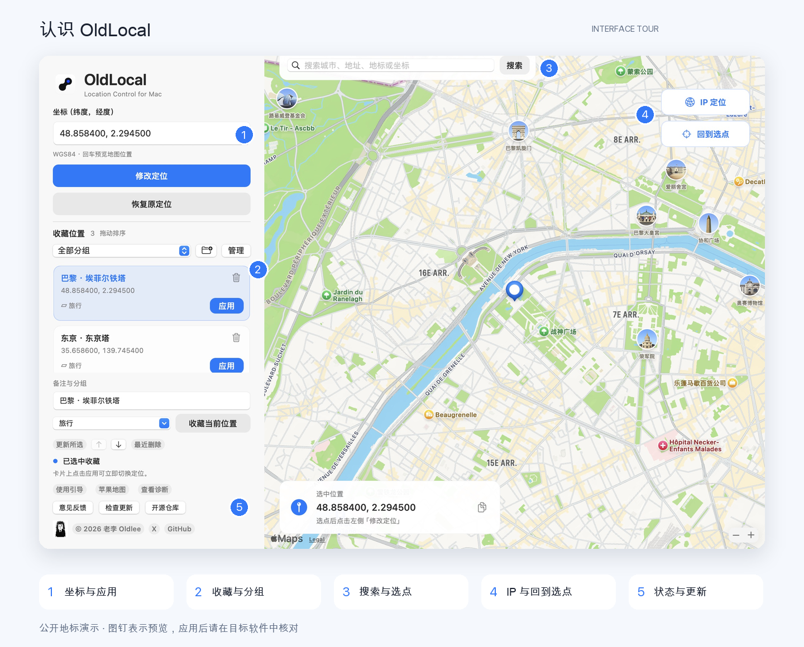
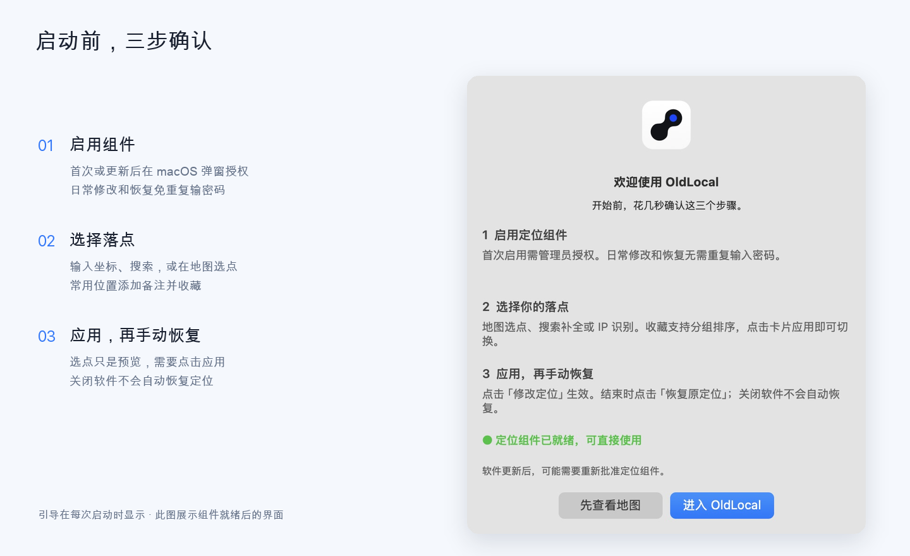
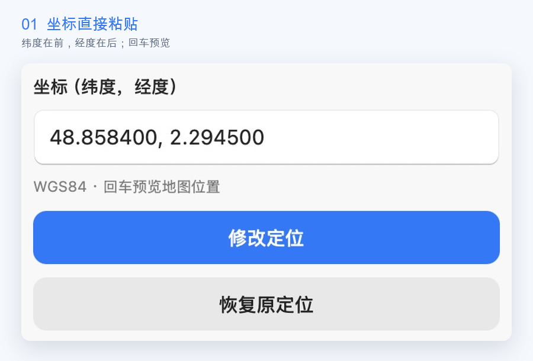
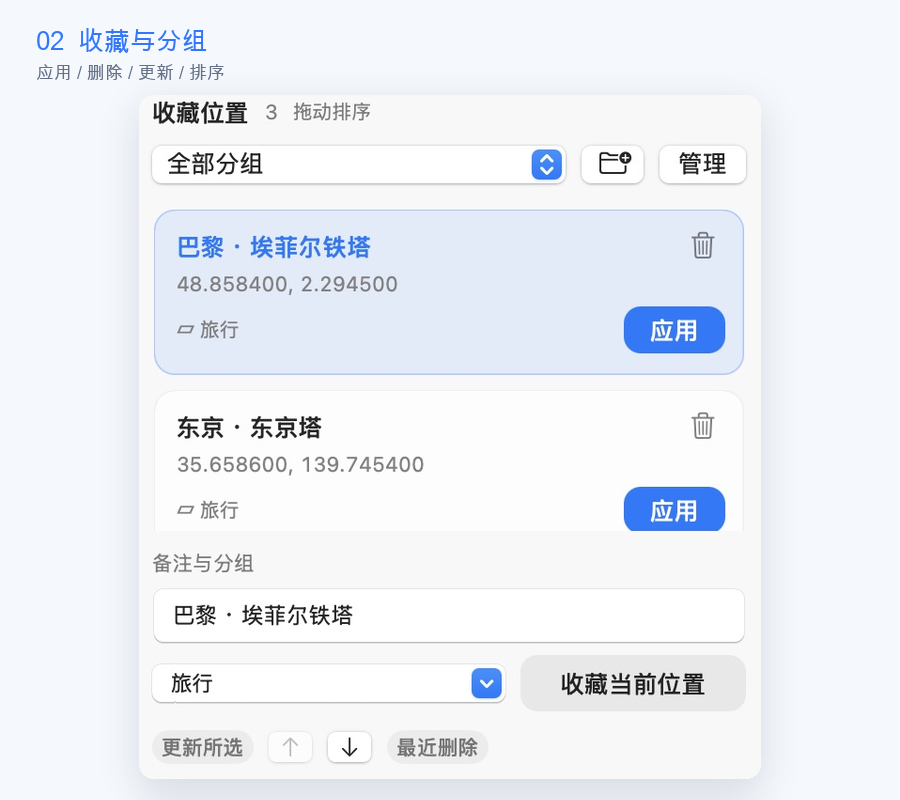
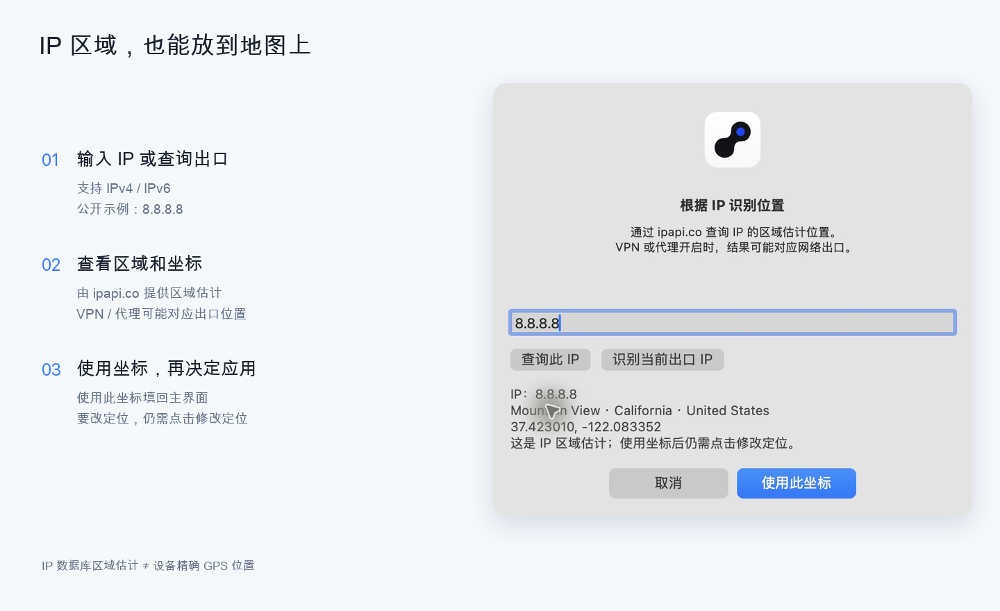
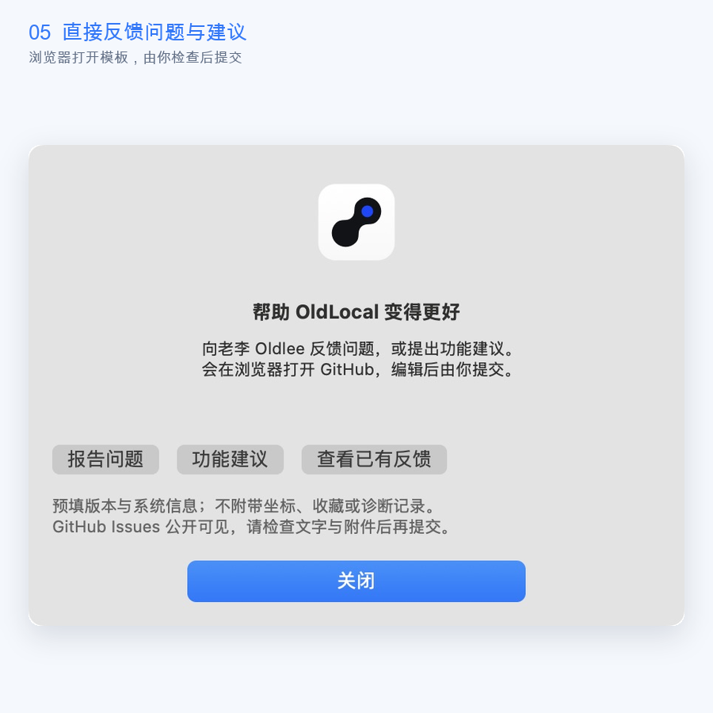
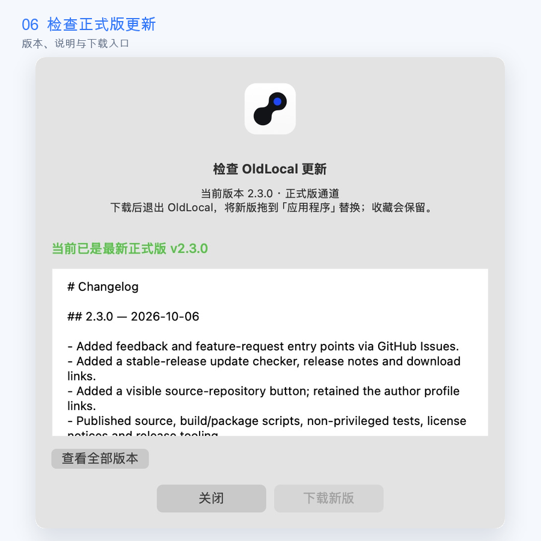

# OldLocal 图文使用教程

[← 返回首页](../README.md) · [常见问题](FAQ.md) · [下载安装包](https://github.com/Oldleeo/OldLocal/releases/latest)

按照「安装 → 选点 → 应用 → 收藏 → 恢复」开始。配图使用隔离的公开地标示例，不读取个人收藏，不执行系统定位修改。



## 目录

- [安装与启用](#install)
- [认识界面](#interface)
- [粘贴经纬度](#coordinates)
- [地图选点与搜索](#map)
- [应用与核对](#apply)
- [收藏、分组、排序与删除恢复](#favorites)
- [IP 区域查询](#ip)
- [恢复原定位](#restore)
- [反馈与更新](#community)
- [完整示例](#example)

<a id="install"></a>
## 01 · 安装与启用

### 下载正确的文件

1. 打开 [最新版本](https://github.com/Oldleeo/OldLocal/releases/latest)。
2. 展开 **Assets**，下载 `OldLocal-macOS-arm64.zip`。
3. 解压，找到 `OldLocal.app`。
4. 拖进 Finder「应用程序」。组件要求应用位于 `/Applications/OldLocal.app`。
5. 从「应用程序」打开 OldLocal。

`Source code (zip)` 和 `Source code (tar.gz)` 是源码，不是直接安装的应用。当前包面向 Apple Silicon，最低构建目标 macOS 15。

### 完成首次授权



1. 引导先检查后台组件。
2. 首次安装或软件更新后，主按钮显示「启用定位组件」，点击它。
3. 在 **系统管理员弹窗** 完成授权。密码只在 macOS 弹窗输入，不发送给开发者。
4. 组件就绪后进入软件，以后日常应用与恢复免重复输密码。

上图展示组件就绪后的引导。「先查看地图」可以先浏览，未启用组件时不能修改或恢复。每次启动都有引导，没有自动跳过设置。

### 如果系统阻止打开

发行包使用 ad-hoc 签名，尚未经过 Apple 公证。确认来自本仓库 Release，然后查看「系统设置 → 隐私与安全性」是否提供允许打开选项。提示和可用操作会随 macOS 版本变化。

没有相应选项或被管理策略拦截时，记录完整提示并到 Issues 反馈，不要为此关闭 SIP。

<a id="interface"></a>
## 02 · 认识界面

| 区域 | 用途 |
| :--- | :--- |
| 左上经纬度 | 单框输入、回车预览。 |
| 修改 / 恢复按钮 | 真正应用模拟位置，或恢复最初保存的系统参数。 |
| 收藏列表 | 点击卡片填回；「应用」直接切换；垃圾桶或右键删除。 |
| 备注与分组 | 保存新位置，或更新所选收藏。 |
| 地图上方搜索 | 搜索城市、地址、地标或坐标，查看补全建议。 |
| IP 定位 | 查询指定 IP 或当前出口的区域坐标。 |
| 回到选点 | 将地图视野拉回所选位置。 |
| 地图底部 | 核对和复制当前选中坐标。 |
| 左下状态与诊断 | 查看操作结果、引导及诊断。 |
| 社区和作者入口 | 反馈、更新、源码、X 和作者 GitHub 主页。 |

图钉代表选中位置，不是其他应用已经采用模拟定位的证明。

<a id="coordinates"></a>
## 03 · 粘贴经纬度



**纬度在前，经度在后**，用逗号分隔。巴黎埃菲尔铁塔公开示例：

```text
48.858400, 2.294500
```

1. 粘贴到左上坐标框。
2. 按回车，地图跳到对应位置。
3. 核对城市与地标。
4. 要应用时，再点「修改定位」。

| 输入规则 | 说明 |
| :--- | :--- |
| 纬度 | `-90` 到 `90`。 |
| 经度 | `-180` 到 `180`。 |
| 分隔符 | 英文或中文逗号均可，两侧空格可保留。 |
| 顺序 | 纬度、经度；颠倒后可能仍合法，所以需要看地图核对。 |
| 坐标系 | WGS84。其他坐标系可能有偏移，当前没有自动转换。 |
| 精度 | 文本显示六位小数；参数读写使用完整浮点精度并核对读回。 |

缺少经度、超出范围、非有限数值等无效输入不会应用。

<a id="map"></a>
## 04 · 地图选点与搜索

### 点击地图

拖动或缩放到想要的位置，点击地图落点。左侧坐标和地图底部「选中位置」同步，确认后点击「修改定位」。

### 用补全找地点


1. 输入城市、地址或地标，两个或更多字符后会尝试显示建议。
2. 点击包含正确地区的建议，或用上下箭头、回车选择。
3. 地图及经纬度更新。
4. 再决定应用或收藏。

点击「搜索」或按回车也可执行搜索。搜索框可以输入与左侧相同格式的坐标。

拖动后找不到图钉时，点 **「回到选点」**。它只调整视野，不重新应用定位。

地图与建议来自 Apple MapKit，需要网络。结果和服务可用性会随地区、网络改变。

<a id="apply"></a>
## 05 · 应用并核对


选点、坐标回车、搜索和 IP 查询都是预览。真正写入有两个入口：左侧 **「修改定位」**，或收藏卡片 **「应用」**。

点击后等待完成，查看左下状态。不要在处理时反复点击或强制退出。

| 状态 | 含义和下一步 |
| :--- | :--- |
| 定位已修改 | 模拟参数读回和服务刷新已确认，继续在目标应用核对位置。 |
| 修改未完成，参数已回退 | 本次没有被视为成功，之前参数已回退。查看诊断。 |
| 系统未允许更新定位 | 刷新被系统拒绝，本次没有写入新的坐标。 |
| 定位组件需要启用 | 打开引导，批准首次安装或新版组件。 |
| 另一项定位操作正在进行 | 等待当前操作完成。 |

点击「苹果地图」打开 Maps，再点击 Maps 的当前位置按钮。如果仍显示旧位置，退出 Maps 再打开并核对。

其他应用可能使用 IP、服务器记录或独立来源。OldLocal 的图钉只是预览，不能代替目标应用中的检查。

<a id="favorites"></a>
## 06 · 收藏、分组和排序



### 新建收藏

1. 选择一个位置。
2. 备注写名字，例如「巴黎 · 埃菲尔铁塔」。
3. 选择分组，或在分组框输入新名称。
4. 点击「收藏当前位置」。备注不能为空。

收藏只保存在本机，不同步到 GitHub。

### 使用和更新

| 操作 | 结果 |
| :--- | :--- |
| 点击卡片 | 填回坐标、备注、分组，预览地图。 |
| 卡片「应用」 / 右键「应用此位置」 | 直接应用该收藏，不需要再点主按钮。 |
| 修改字段后「更新所选」 | 改动选中收藏，保留身份，不新增条目。 |
| 「收藏当前位置」 | 新增一条，即使已经选择了某张卡片也仍是新增。 |

### 管理分组

列表上方下拉框筛选，文件夹加号创建分组，旁边 **「管理」** 打开分组窗口。


- **重命名**：选分组 → 输入新名称 →「重命名」。最近删除中的所属分组也同步。
- **删除分组**：选分组 →「删除分组」→ 确认。组内收藏移到「未分组」，保留坐标、备注、ID 和相对顺序。
- **撤销**：管理窗口内「撤销此操作」恢复最近一次分组操作前的数据。关闭窗口后记录结束。

默认「未分组」不能删除或重命名；「全部分组」仅是筛选项，不可作为组名，已有名称也不能重复创建。

### 排序

选中收藏，再点备注区下方上移或下移箭头，顺序会保存。界面也提供拖动排序；上下按钮已实机验证，拖拽手势尚未完成自动 GUI 验证。

### 删除与恢复

1. 卡片垃圾桶或右键「删除收藏」。
2. 确认后进入「最近删除」。
3. 点击备注区下方「最近删除」，选择条目，点「恢复收藏」。
4. 备注、坐标与分组保留。

删除收藏不等于恢复定位。删除正在使用的位置，也不会改变已应用的系统参数。

<a id="ip"></a>
## 07 · IP 区域查询



1. 右上「IP 定位」。
2. 输入有效 IPv4 / IPv6，例如公开测试 IP `8.8.8.8`。
3. 点击「查询此 IP」。
4. 阅读 IP、区域与坐标，点「使用此坐标」填回。
5. 要应用时，再点「修改定位」。

「识别当前出口 IP」向 ipapi.co 查询当前网络出口的区域位置。VPN 或代理开启时，可能对应代理出口。

IP 数据库给出区域估计，不是设备精确 GPS；结果可能随数据源变化。OldLocal 不改变公网 IP、不切换 VPN。查询限流或失败时稍后重试，可先用公开 IP 测试。

<a id="restore"></a>
## 08 · 使用结束，恢复原定位

1. 点左侧「恢复原定位」。
2. 等待结果，确认「原定位已恢复」。
3. 在目标应用核对；缓存未更新时退出后重新打开。

恢复使用最初保留的模拟参数备份，不是撤销到上一条收藏，也不是按 IP 猜一个位置。

「参数已恢复，刷新待确认」表示参数恢复已核对，但服务刷新没有完全确认，需要继续检查地图和诊断。

**关闭软件不会自动恢复。** 卸载前先恢复，再用「OldLocal → 移除定位组件…」移除后台，最后删除应用。组件移除保留收藏和原定位备份。

不要删除 `/var/db/mac-location-lab/original.json` 来排错。恢复失败时保留备份与完整状态，见 [常见问题](FAQ.md)。

<a id="community"></a>
## 09 · 反馈与更新



「意见反馈」选择报告问题或功能建议，浏览器打开本仓库 Issues，预填模板，登录 GitHub 后由你提交。写清版本、系统、复现步骤、完整状态、预期与实际结果。

Issues 公开可见。截图和诊断提交前先检查个人信息，软件不会自动附带坐标、收藏或诊断。



1. 「检查更新」，也可从 OldLocal 菜单打开。
2. 阅读最新正式版本及说明。
3. 有新版和应用包时点击「下载新版」。
4. 退出软件，解压并拖入应用程序替换。
5. 重开后通过引导批准更新后的组件。

目前手动替换，不自动安装。收藏在用户资料目录，替换应用不删除收藏。

「开源仓库」打开本项目，底部「GitHub」保留作者个人主页。

<a id="example"></a>
## 10 · 完整公开地标示例

| 步骤 | 操作 |
| :--- | :--- |
| 选点 | 输入 `48.858400, 2.294500`，回车。 |
| 核对 | 地图显示巴黎及对应落点。 |
| 收藏 | 备注「巴黎 · 埃菲尔铁塔」，分组「旅行」，收藏。 |
| 测试 | 按需要点击「修改定位」，核对状态和目标应用。 |
| 切换 | 从其他已保存测试点点击卡片「应用」。 |
| 结束 | 「恢复原定位」，检查状态及目标应用位置。 |

公开坐标用于学习操作，请按自己的测试需要决定是否实际应用。

---

[← 首页](../README.md) · [故障排查](FAQ.md) · [反馈](https://github.com/Oldleeo/OldLocal/issues)
